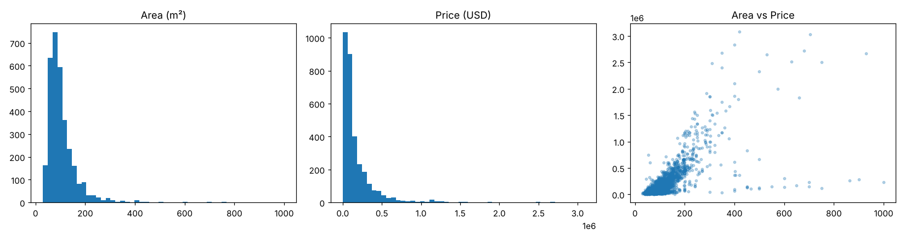
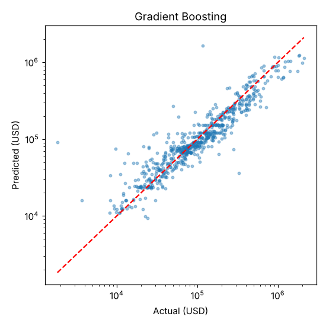

# Tehran House Price Prediction (Regression)

Predicting apartment prices in Tehran from basic property features, using classical regression models in Python and scikit-learn.

This project is an assignment from a machine learning course (Maktabkhooneh).

## Dataset

`housePrice.csv` contains roughly 3,500 real apartment listings in Tehran.

| Column | Description |
|---|---|
| `Area` | Floor area in square meters |
| `Room` | Number of bedrooms |
| `Parking` | Has parking (True/False) |
| `Warehouse` | Has storage room (True/False) |
| `Elevator` | Has elevator (True/False) |
| `Address` | Approximate neighborhood in Tehran |
| `Price` | Price in Toman |
| `Price(USD)` | Price in US dollars (**target**) |

## Data Cleaning

The raw data has several problems, handled in the notebook:

1. **`Area` is stored as text.** Some values contain thousands separators and spaces (e.g. `" 1,000 "`), so it is converted to a number.
2. **Missing addresses.** 23 rows have no `Address` and are removed.
3. **Wrong area values.** Some entries are absurdly large (e.g. 16,160,000,000 or 3,600 m²). Rows with `Area > 1000` are removed. The 1000 m² threshold is a judgment call.
4. **Duplicates.** 208 duplicated rows are removed.

Result: 3,479 rows reduced to 3,243 clean rows.

## Approach

- **Target:** `log(Price(USD))`. Prices are strongly right-skewed, so training on the log scale gives more stable models. Predictions are converted back to dollars for evaluation.
- **Leakage prevention:** `Price` (Toman) and `Price(USD)` carry the same information, so only the USD column is used as the target and the Toman column is not used as a feature.
- **Features:** `Area`, `Room`, `Parking`, `Warehouse`, `Elevator` and one-hot encoded `Address`.
- **Split:** 80% train / 20% test (`random_state=42`), plus 5-fold cross-validation.
- **Models:** Linear Regression, Ridge, Random Forest, Gradient Boosting.



## Results

Test-set metrics (20% hold-out):

| Model | R² (log) | R² (USD) | MAE (USD) | RMSE (USD) | CV R² (log) |
|---|---|---|---|---|---|
| **Gradient Boosting** | **0.856** | **0.765** | 50,964 | 126,972 | 0.831 |
| Linear Regression | 0.847 | 0.626 | 53,735 | 160,050 | 0.842 |
| Ridge | 0.845 | 0.537 | 54,589 | 178,077 | 0.837 |
| Random Forest | 0.829 | 0.725 | 50,021 | 137,208 | 0.801 |



## Discussion

- **Best model:** Gradient Boosting has the highest R² on the test set, both on the log scale (0.856) and in dollars (0.765). It also has the lowest RMSE, meaning it handles expensive apartments best.
- **Linear models are competitive on the log scale** (R² ≈ 0.85, and the best cross-validated score), which shows the log transform captures much of the structure. They do worse in dollars because errors on the log scale become large when converted back for expensive properties.
- **Random Forest** has the lowest MAE but lower R², and the weakest cross-validation score, which suggests it overfits more than the other models here.
- **What drives price:** `Area` has the strongest correlation with price (about 0.70), followed by `Room` (about 0.57). Neighborhood also matters a lot; the highest median prices are in areas such as Gandhi, Lavasan, Vanak and Elahieh. Parking, warehouse and elevator have weak correlations (about 0.11 to 0.19).
- **Errors:** An MAE of about $50,000 is large relative to the median price (about $99,000), so predictions are rough for individual apartments. Errors are largest for luxury properties.

### Limitations

- Only 6 input features. Missing information such as building age, floor, renovation state and exact location limits accuracy.
- Many neighborhoods have very few listings, so their price estimates are unreliable.
- The 1000 m² cleaning threshold and the removal of duplicates are modeling choices that affect results.
- Prices come from a single snapshot, and Iranian prices change quickly with inflation and exchange rates, so the model may not generalize to other periods.
- Hyperparameters were set by hand, not tuned.

### Possible improvements

- Tune hyperparameters with `GridSearchCV` or `RandomizedSearchCV`.
- Try target encoding for `Address`, or group rare neighborhoods together.
- Try XGBoost or LightGBM.
- Add engineered features such as area per room.

## How to Run

```bash
pip install pandas numpy matplotlib scikit-learn jupyter
jupyter notebook house_price_regression.ipynb
```

Keep `housePrice.csv` in the same folder as the notebook. You can also upload both files to Google Colab and use *Runtime → Run all*.

## Project Structure

```
├── house_price_regression.ipynb   # full analysis and modeling
├── housePrice.csv                 # dataset
├── images/                        # figures used in this README
└── README.md
```

## License

See the [LICENSE](LICENSE) file.
